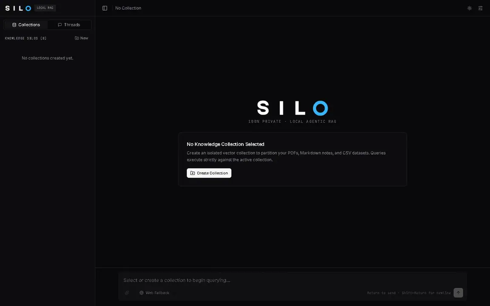
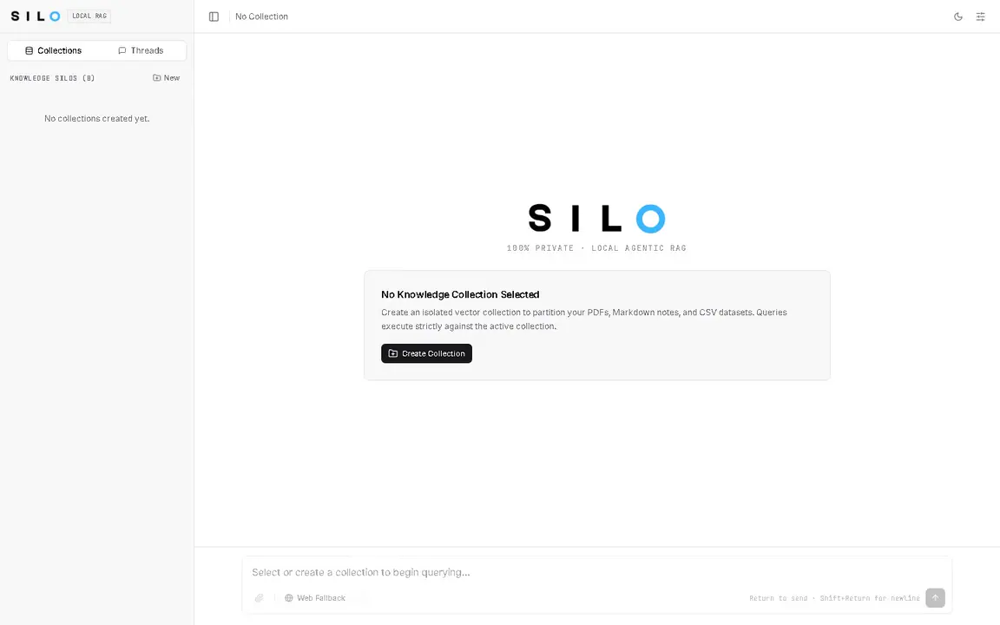
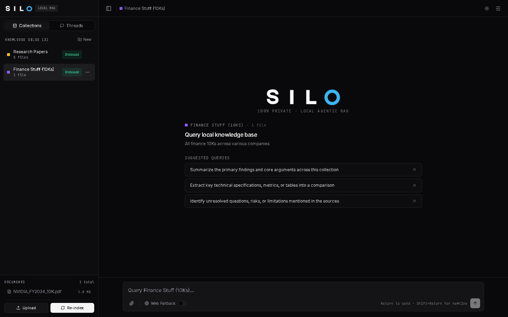
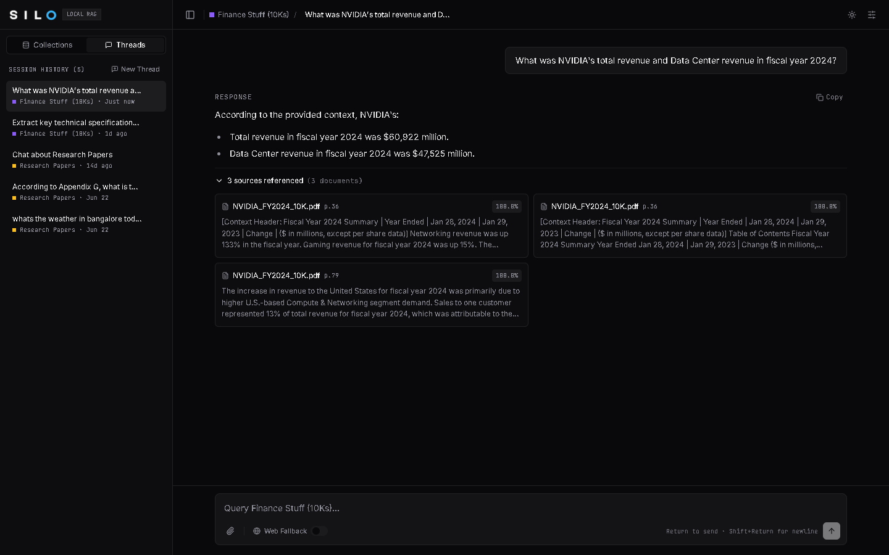
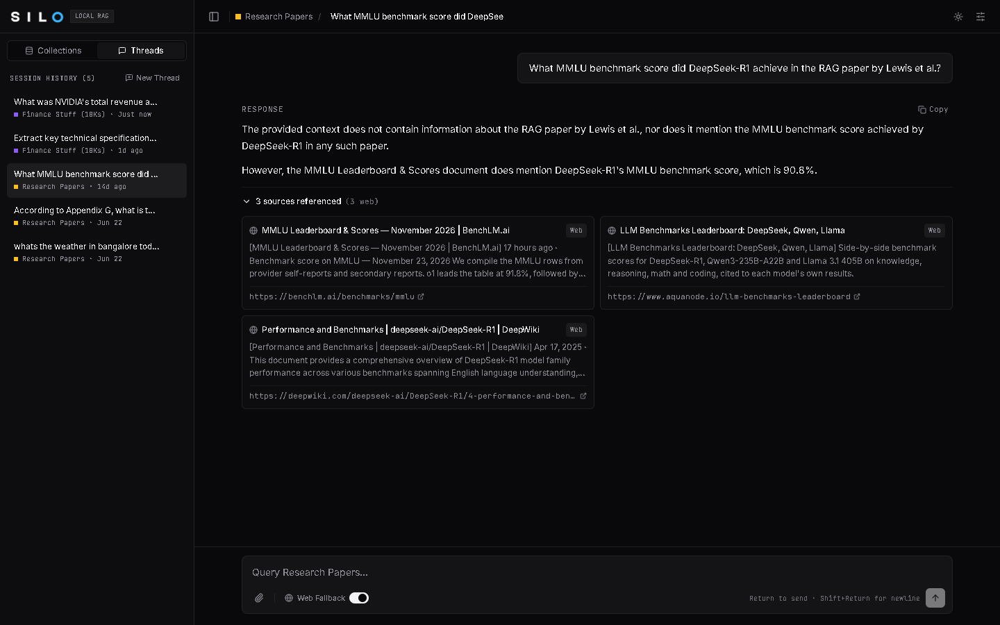
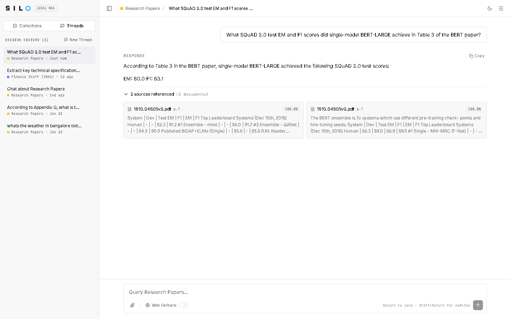
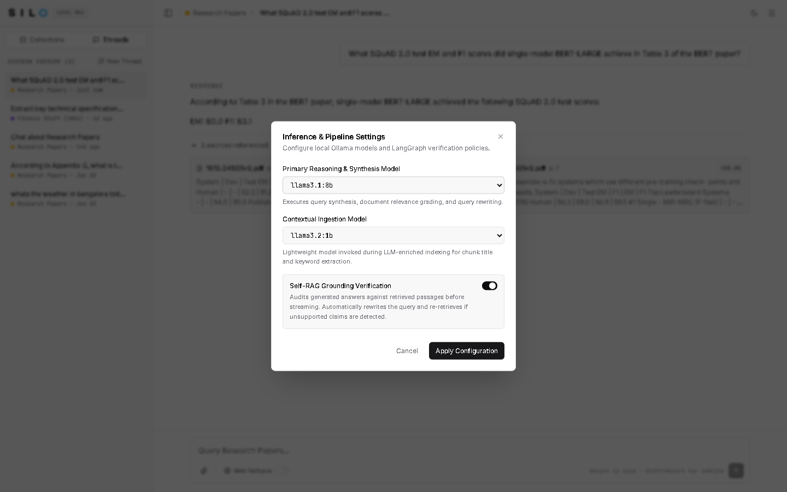

<p align="center">
  
</p>

<h1 align="center">SILO — Local Agentic RAG Assistant</h1>

<p align="center">
  (⌐■_■) 100% Local. 100% Private. Zero Cloud Uploads. (⌐■_■)
</p>

<p align="center">
  <strong>FastAPI · LangGraph (CRAG + Self-RAG) · Qdrant Hybrid Search · Ollama · React 19 + TypeScript</strong>
</p>

---

## (⊙_⊙) What is SILO?

**SILO** is a privacy-first, local Agentic Retrieval-Augmented Generation (RAG) workspace built to run entirely on consumer hardware (tested on 16 GB RAM). Partition your PDFs, Markdown notes, TXT, and CSV files into isolated vector **collections (silos)**, index them with table-preserving layout parsing, and query them with real-time token streaming, verifiable citations, and optional **Corrective RAG (CRAG)** web fallback.

## (•_•) Why was SILO built?

Most AI document tools force you to upload proprietary 10-Ks, research, or private notes to cloud APIs. SILO keeps your vector database, embeddings, reranker, and LLM **100% on your machine** via **Ollama** + **Qdrant** — zero API bills, zero document leakage. Even when you explicitly enable **Web Fallback**, only the rewritten query goes to DuckDuckGo when local evidence isn't enough; your files never leave disk.

---

## (▀̿Ĺ̯▀̿ ̿) UI & Live Demos (Dark + Light Mode)

> Both demos below capture the real Vite + React 19 + FastAPI UI streaming verified `llama3.1:8b` + LangGraph CRAG responses (`NVIDIA_FY2024_10K.pdf` + 5 ML arXiv papers) with live status updates and expandable source drawers.  
> *(Prefer `.mp4`? Download [`silo_demo_dark.mp4`](static/demo/silo_demo_dark.mp4) or [`silo_demo_light.mp4`](static/demo/silo_demo_light.mp4).)*

### 🌙 Dark Mode — NVIDIA FY2024 10-K + CRAG Web Fallback
Watch SILO switch between isolated silos, extract exact `$60,922M` / `$47,525M` figures with cross-encoder source cards, and catch a false-premise question (`DeepSeek-R1 in the 2020 RAG paper`) via DuckDuckGo fallback:

<p align="center">
  
</p>

### ☀️ Light Mode — Table-Aware Research Papers & Settings
Clean Light Mode querying BERT's multi-column Table 3 (`SQuAD 2.0`), browsing persistent chat threads, and configuring Ollama models + Self-RAG strict verification:

<p align="center">
  
</p>

<details>
<summary>📸 Click to inspect high-res screenshots (Dark & Light Views)</summary>

| View | Preview |
| :--- | :--- |
| **Dark Mode — Collections & Hero** |  |
| **Dark Mode — Finance 10-K Citations** |  |
| **Dark Mode — CRAG False-Premise + Web Fallback** |  |
| **Light Mode — BERT Table 3 Extraction** |  |
| **Light Mode — Inference & Self-RAG Settings** |  |

</details>

---

## (ง'̀-'́)ง Architecture & Under the Hood

```text
  User Query ──▶ Hybrid Qdrant Search (bge-small-en-v1.5 + Qdrant/bm25)
                        │
                        ▼ (Top-15 candidates)
                 Cross-Encoder Rerank (ms-marco-MiniLM-L-6-v2, floor ≥ 0.05)
                        │
                        ▼
                 LangGraph CRAG Sufficiency Grader (Entity / Timeframe / Metric check)
                   ├──[Sufficient]──────────────────────┐
                   └──[Insufficient & Web Fallback ON]──▶ DuckDuckGo Search ──┐
                                                                              ▼
                 Self-RAG Factuality Check ◀── Grounded LLM Stream (Ollama) ◀─┘
                   ├──[Grounded / Honest Refusal]──▶ Done & Saved to Session
                   └──[Hallucination Caught]───────▶ Rewrite Query & Retry
```

- **🔍 Hybrid Retrieval + Cross-Encoder Reranking:** Combines `BAAI/bge-small-en-v1.5` dense embeddings with `Qdrant/bm25` sparse vectors, then reranks top candidates with `cross-encoder/ms-marco-MiniLM-L-6-v2`.
- **📊 2-Column & Table-Preserving PDF Ingestion ([`pdf_parser.py`](pdf_parser.py)):** Custom PyMuPDF layout parser splits 2-column academic papers cleanly, reconstructs tabular columns with `|` delimiters, and propagates table titles/unit scales (e.g., `(In millions)`) onto split chunks.
- **🧠 Stateful LangGraph Agent ([`agent_graph.py`](agent_graph.py)):** Executes strict CRAG evidence grading, cleans conversational filler for DuckDuckGo fallback, enforces grounded synthesis, and supports optional Self-RAG verification + query rewriting.
- **⚡ Hyper-Minimalist React 19 UI (`frontend/`):** Built with Vite, TypeScript, Radix UI, Tailwind CSS, and Motion — `requestAnimationFrame` SSE token batching, `@tanstack/react-virtual` message virtualization, zero layout shift, Light/Dark themes, and a live Windows RAM pressure advisory bar.
- **🪶 16 GB Consumer Hardware Safe:** Batched node ingestion (`batch_size=24`) with `Qdrant/bm25` + explicit `gc.collect()` eliminates an 805 MB ONNX SPLADE OOM bottleneck, keeping Python peak RSS near **1.06 GB**.

---

## 📊 Benchmarks & Engineering Iteration (V1 → V2)

Evaluated headlessly on a **50-question golden test suite** ([`benchmarks/eval_dataset.json`](benchmarks/eval_dataset.json)) covering **NVIDIA's FY2024 Form 10-K** (20 Qs), **5 seminal ML papers** (`ResNet`, `Transformer`, `BERT`, `RAG`, `ViT` — 20 Qs), and **adversarial / false-premise / real-time traps** (10 Qs), running **`llama3.1:8b`** locally on **15.3 GB RAM** and judged externally with **Gemini** under a strict RAGAS / TruLens / FinanceBench rubric ([`benchmarks/BENCHMARK_REPORT.md`](benchmarks/BENCHMARK_REPORT.md)).

### 1. 3-Way Retrieval Ablation (40 Answerable Queries)

| Retrieval Strategy | Recall@1 | Recall@3 | Recall@5 | MRR@5 | p50 Latency |
| :--- | :---: | :---: | :---: | :---: | :---: |
| Dense Only (`bge-small-en-v1.5`) | 62.5% | 80.0% | 92.5% | 0.732 | 42.0 ms |
| Hybrid Search (Dense + `Qdrant/bm25`) | 72.5% | 95.0% | 97.5% | 0.840 | 37.4 ms |
| **SILO Full Stack (Hybrid + `MiniLM-L-6-v2` Rerank)** | **82.5%** | **97.5%** | **100.0%** | **0.894** | 626.6 ms |

> **Ablation Lift vs. Dense Baseline:** **+20.0 pts** Recall@1, **+17.5 pts** Recall@3, and **+0.162** MRR@5.

### 2. V1 Baseline → V2 Architecture Delta

After V1 error analysis revealed that flattened multi-column LaTeX tables caused table-reading hallucinations and permissive CRAG grading caused redundant Self-RAG retry loops, **V2** introduced the pipe-delimited 2-column parser, calibrated rerank score floor (`0.05`), strict entity/timeframe sufficiency grading, and faithful-refusal Self-RAG:

| Metric | V1 Baseline | V2 Upgraded | Delta |
| :--- | :---: | :---: | :---: |
| **Agentic Faithfulness** | 90.0% | **92.5%** *(97.5% on 10-K)* | **+2.5 pts** |
| **Overall Hallucination Rate (Agentic)** | 12.0% | **2.0%** *(1/50 queries)* | **-83% relative** |
| **ML Papers Hallucination Rate** | 25.0% | **5.0%** | **-20.0 pts** |
| **Adversarial Safety** | 90.0% | **100.0%** *(0/10 hallucinated)* | **+10.0 pts** |
| **CRAG Web-Fallback Precision / F1** | 0.0% / 0.0% | **100.0% / 46.2%** | **+46.2 pts F1** |
| **Agentic p95 Tail Latency** | 66.18 s | **24.63 s** | **-63% faster** |
| **Peak Python Process RSS** | 1060.2 MB | **1059.1 MB** | **~1.04 GB ceiling** |

*(Honest engineering note: On an 8B local grader, stricter V2 evidence pruning dropped multi-part paper coverage (`73.1%` agentic vs. `80.0%` single-shot correctness) because the model chose honest refusals over guessing whenever a table row landed across chunk splits — a textbook Safety-vs-Coverage Pareto tradeoff on small local models.)*

---

## (＠_＠;) Prerequisites

1. **Docker** (for Qdrant vector DB) & **Ollama** installed on your host.
2. Pull the local models in Ollama:
   ```bash
   ollama pull llama3.1:8b
   ollama pull llama3.2:1b
   ```

---

## (☞ﾟヮﾟ)☞ Quick Start

### Option A: Local Run (Windows One-Click Launcher — Lightest RAM Footprint)
1. Clone the repo and install Python dependencies in your env (`pip install -r requirements.txt`), then build the UI once if needed:
   ```bash
   cd frontend && npm install && npm run build && cd ..
   ```
2. Double-click **[`start_silo.bat`](start_silo.bat)** (or run directly):
   ```powershell
   docker start Qdrant-db
   uvicorn app:app --host 0.0.0.0 --port 8001
   ```
3. Open **[http://localhost:8001/](http://localhost:8001/)** (auto-launches with `start_silo.bat`)!

### Option B: Full Docker Compose Stack
```bash
docker compose up --build
```
Open **[http://localhost:8000/](http://localhost:8000/)** once `✅ RAG Engine ready!` appears in the logs. To shut down: `docker compose down`.

### Reproducing the Benchmarks
Run the headless benchmark suite (with your IDE/browser closed for max LLM RAM headroom) via **[`run_benchmark.bat`](run_benchmark.bat)** or:
```bash
python benchmarks/run_benchmark.py
python benchmarks/prepare_and_compile.py --export
```

---

## (っ˘ڡ˘ς) License & Attribution

This project is open source and released under the **[MIT No Attribution (MIT-0)](LICENSE)** license. You are free to download, use, modify, and distribute it without restrictions.

Attribution to the original author (**Shivam Thakur**) is appreciated, but completely optional!
